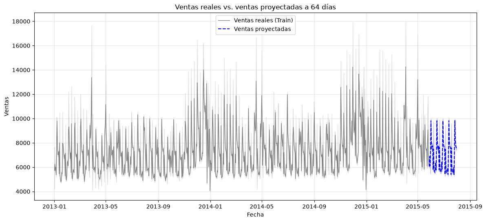
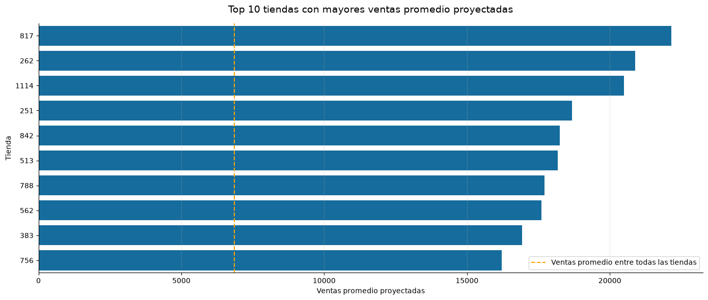
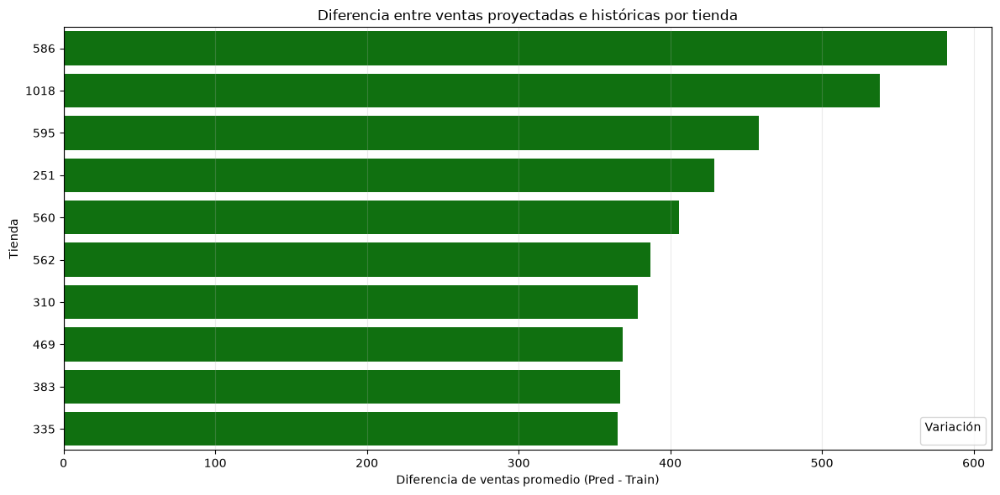
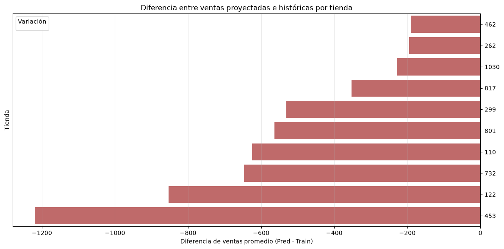
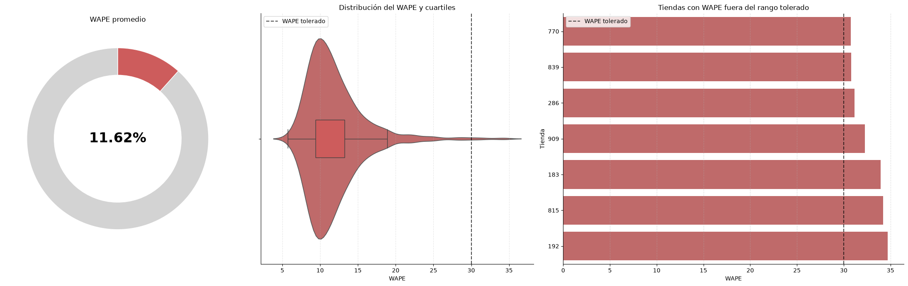

# Informe ejecutivo – Rossmann Sales Forecast
Predicción de ventas diarias por establecimiento · Horizonte de seis semanas

## 1. Resumen ejecutivo

### Indicadores generales del modelo

- Cantidad de tiendas analizadas: **1115**
- Horizonte temporal de las predicciones: **64 días**
- Ventas totales proyectadas: **424.598.600 €**
- Promedio general de ventas diarias proyectadas: **6.950 €**
- MAPE global del modelo sobre el conjunto de test: **11,62 %**

### Conclusiones y recomendaciones

El modelo ofrece **proyecciones estables y confiables a nivel general**, con un **WAPE promedio del 11,62 %** y la mayoría de las tiendas concentradas cerca del **10 %–13 %**. Además, conserva el **ciclo semanal** y suaviza los picos extremos, presentando variaciones acotadas en el promedio proyectado a 60 días frente al histórico (en relación con la desviación estándar de **3.095 €**).

Estos resultados proporcionan una **base cuantitativa sólida para priorizar el presupuesto de renovación**, especialmente en tiendas de alta facturación promedio proyectada, como **817, 262 y 1114**, que superan los **20.000 €**, así como para considerar sucursales con una **leve mejora en su nivel promedio esperado**, como **586, 1018 y 595**.

Queda bajo el **criterio y análisis posterior del CFO** auditar y decidir la asignación de capital en los casos atípicos:

- **7 tiendas con WAPE superior al 30 %:** 770, 839, 286, 909, 183, 815 y 192.
- **Sucursales con mayores contracciones en su promedio proyectado respecto al histórico:** 453, 122 y 732.

En estos casos, se recomienda **evaluar el impacto financiero, estacional y estratégico** antes de comprometer inversión.

## 2. Proyecciones y análisis de tiendas

### 2.1. Proyección de ventas

* Comportamiento del modelo: La proyección (línea azul punteada, entre mediados de 2015 y agosto de 2015) conserva el patrón cíclico semanal y se mueve en un rango similar al nivel base habitual (~6.000 a ~10.000), pero tiende a suavizar los picos extremos que se observan en el histórico (como los repuntes de fin de año en 2013 y 2014 o ciertos picos puntuales por encima de 14.000–18.000).

* Alineación con el negocio: Para el horizonte de planificación financiera del CFO (centrado en las próximas 6 semanas, y aquí extendido a 64 días), la proyección entrega una línea base estable útil para comparar el ritmo ordinario de ingresos entre tiendas, aunque conviene vigilar el MAPE en períodos de alta volatilidad o estacionalidad marcada para no subestimar picos de caja al decidir inversiones en renovación.

### 2.2. Tiendas con mayores ventas proyectadas

* Hallazgo principal: Las diez tiendas líderes —encabezadas por las sucursales 817, 262 y 1114, que superan los €20.000 de venta diaria promedio proyectada— duplican con holgura y hasta triplican la media general de la cadena (ubicada cerca de €6.800–€7.000, línea naranja punteada). 

* Alineación con el negocio: Esta diferenciación entrega al CFO un criterio cuantitativo directo para jerarquizar el presupuesto de renovación: estas sucursales concentran el mayor potencial de generación de ingresos futuros, por lo que permiten evaluar tanto inversiones orientadas a proteger y maximizar el retorno en tiendas de mayor facturación como la capacidad de repago de cada reforma. 

### 2.3. Tiendas con mayor crecimiento proyectado

* Hallazgo principal: Las diez tiendas con mayor incremento proyectado presentan una diferencia positiva de entre €365 y €580 al comparar su venta promedio proyectada para los próximos 60 días frente a su promedio histórico de entrenamiento (lideradas por las tiendas 586 con +€580, 1018 con +€538 y 595 con +€458). En términos de escala operativa, un desplazamiento de ~€500 en el promedio del período es una variación acotada y representa apenas entre el 11,8% y el 18,7% de la desviación estándar de €3.095, lo que demuestra que el modelo proyecta continuidad y estabilidad respecto al histórico, sin saltos bruscos ni sobreestimaciones artificiales. 

* Alineación con el negocio: Para el CFO, este comportamiento aporta doble valor: confirma que las estimaciones a futuro mantienen una base prudente —evitando inflar expectativas de ingresos al evaluar el retorno de una reforma— y permite identificar sucursales con una leve mejora en su nivel promedio de facturación (como 251, 562 y 383, que además figuran entre las de mayor venta promedio proyectada), aunque por tratarse de diferencias moderadas de promedio deben complementarse con criterios financieros y operativos antes de asignar el presupuesto de renovación. 

### 2.4. Tiendas con mayor decrecimiento proyectado

* Hallazgo principal: Las diez tiendas con mayor contracción proyectada presentan una diferencia negativa de entre -€190 y -€1.215 al comparar su venta promedio proyectada para los próximos 60 días frente a su promedio histórico de entrenamiento, encabezadas por las sucursales 453 (-€1.215), 122 (-€850) y 732 (-€645). Frente a la desviación estándar de €3.095, estos retrocesos en el promedio del período equivalen a entre el 6% y el 39% de una desviación estándar (superando en magnitud absoluta a las mayores alzas proyectadas). Además, destacan las tiendas 817 (-€350) y 262 (-€195), que aunque lideran el ranking de facturación promedio proyectada, exhiben un ajuste acotado a la baja respecto a su media histórica. 

* Alineación con el negocio: Para el CFO, este resultado actúa como un radar de riesgo y eficiencia de capital: permite postergar o auditar antes de renovar aquellas sucursales con retrocesos más marcados en su nivel promedio esperado (como la 453 o la 122) para determinar si la caída obedece a estacionalidad del período, competencia o deterioro operativo, evitando comprometer presupuesto donde la facturación media tiende a contraerse. En casos como 817 y 262, la variación en su promedio es marginal frente a su alto nivel de facturación (>€20.000), por lo que mantienen su atractivo para inversión bajo un criterio financiero prudente.

### 2.5. Desempeño predictivo por tienda

* Hallazgo principal: El modelo logra un WAPE promedio del 11,62%, con la mayor concentración de tiendas alrededor de 10%–13% y el grueso de la distribución por debajo de 20%. Sin embargo, existen 7 sucursales que superan el umbral de tolerancia fijado en 30% (770, 839, 286, 909, 183, 815 y 192, llegando esta última cerca del 35%). 

* Alineación con el negocio: Desde la perspectiva del CFO, el error global es bajo y respalda el uso de las proyecciones para la planificación financiera general de la cadena. No obstante, para asignar presupuesto de renovación tienda por tienda, conviene tratar con cautela las estimaciones de esas 7 sucursales atípicas (revisando posibles cambios operativos, refacciones recientes o anomalías en su serie histórica) antes de comprometer capital en ellas. 

## 3. Conclusiones y consideraciones

* Comportamiento general esperado: Las ventas proyectadas mantienen de forma consistente el ciclo semanal observado en el histórico, moviéndose dentro de una franja estable y conservadora (~€6.000 a ~€10.000 en la serie agregada/referencia) y suavizando los picos extremos del pasado. El modelo respalda esta previsibilidad con un WAPE promedio del 11,62% y la mayor parte de las tiendas ubicadas en torno al 10%–13% de error, evitando saltos bruscos en el promedio esperado para los próximos 60 días.

* Concentración de ingresos: Existe una marcada diferencia entre las tiendas líderes y la media de la cadena (situada cerca de €6.800–€7.000 de venta promedio proyectada). El Top 10 de facturación promedio proyectada —encabezado por las tiendas 817, 262 y 1114, que superan los €20.000— duplica y hasta triplica el promedio general, concentrando el mayor potencial de generación de caja futura para respaldar decisiones de inversión.

* Evolución esperada de los establecimientos: Al comparar la venta promedio proyectada a 60 días frente al promedio histórico de entrenamiento, la mayoría de las variaciones se mantiene acotada respecto a la desviación estándar de €3.095:
  * Expansión moderada: Las 10 tiendas con mayor alza esperada muestran incrementos de entre +€365 y +€580 en su promedio (lideradas por 586, 1018 y 595, equivalentes al 11,8%–18,7% de una desviación estándar), destacando sucursales como 251, 562 y 383 que combinan alta facturación promedio con mejora esperada.
  * Contracción focalizada: Las 10 tiendas con mayor caída proyectada registran retrocesos de entre -€190 y -€1.215 en su promedio (encabezadas por 453, 122 y 732, entre el 6% y el 39% de una desviación estándar); mientras que en tiendas líderes como 817 (-€350) y 262 (-€195) el ajuste es marginal frente a su alto volumen base.

* Consideraciones para la planificación de inversiones: Las estimaciones sirven como insumo cuantitativo confiable para que el CFO priorice el presupuesto de renovación hacia establecimientos de alta facturación promedio proyectada (como 817, 262 y 1114) y monitoree aquellas con señales positivas (como 586, 1018, 595, 251, 562 y 383). Queda bajo evaluación posterior del CFO auditar antes de asignar capital en dos frentes críticos: las 7 tiendas con error WAPE superior al 30% (770, 839, 286, 909, 183, 815 y 192) y las sucursales con caídas pronunciadas respecto a su promedio histórico (como 453, 122 y 732), analizando factores estacionales, competitivos u operativos antes de comprometer presupuesto.